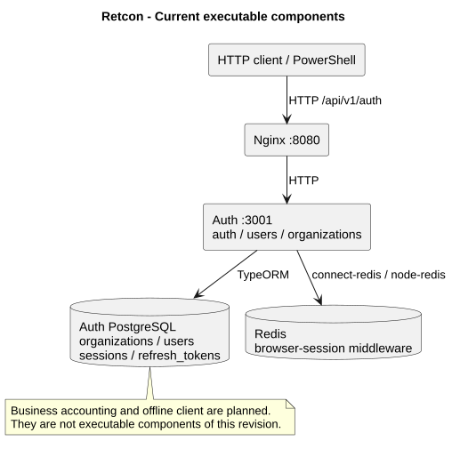

# Retcon - Returnable Containers

**A reusable-container tracking system with offline operation capture and synchronization conflict resolution.**

The [full future product concept](docs/future/README.md) expands Retcon with container accounting, settlements and deposits, an accountant workspace, deliveries and collections, a live supplier map, and a target microservice architecture using gRPC. It includes user scenarios, data models, acceptance criteria and a phased implementation plan. These are planned capabilities; the implementation status below remains the current baseline.

I am developing Retcon as my individual graduation project. I want warehouse and logistics staff to record how reusable packaging moves between locations, retain the history of each item, and reconcile operations recorded while connectivity is unavailable.

## Project information

| Field                        | Details                                                                                                       |
| ---------------------------- | ------------------------------------------------------------------------------------------------------------- |
| Student and sole contributor | **Бартай Ғалым Рахымжанұлы**                                                                                  |
| My responsibilities          | Research, requirements, architecture, backend, subsequent client implementation, evaluation and documentation |
| Supervisor                   | **Макатов Арстан Кутжанович**                                                                                 |
| Repository                   | [coonfituuree/retcon](https://github.com/coonfituuree/retcon)                                                 |
| Project management           | [Retcon YouTrack](https://coonfituuree.youtrack.cloud/)                                                       |
| Documentation status         | 23 October 2026; [submission checklist](docs/management/submission-checklist.md)                              |

## Problem and target users

Reusable pallets, crates and similar assets circulate between warehouses and partners. An accounting system needs to establish where each item is located and which recorded operations explain that state. Delayed uploads, repeated requests and incompatible observations can make records disagree.

My target users are warehouse operators who register movements, administrators who manage access and investigate discrepancies, and auditors who inspect history. These are product roles; I work on the project alone. I am validating the actual users' processes separately and do not present interview plans as completed interviews.

## Aim and expected outcomes

My aim is to develop and evaluate a system that preserves operation history and produces explainable accounting results despite temporary loss of connectivity and concurrent changes.

I plan to deliver:

- An individually identified container register, locations and movement history.
- A client that records operations locally and uploads them after connectivity returns.
- A synchronization protocol that handles retries and detects incompatible operations.
- An administrator workflow that records how a discrepancy was resolved.
- A runnable application, documented architecture and reproducible evaluation results.

I do not claim measured economic savings, environmental benefits or a new cryptographic algorithm.

## Scope and current development status

The initial milestone covers identity, container accounting, offline capture, synchronization and conflict review. Its original scope deferred financial settlement, route planning, RFID equipment and a production HA platform. The [expanded future scope](docs/future/README.md) now includes settlements, deposits, delivery and collection planning, and a live supplier map. A complete ERP and advanced route optimization remain later possibilities; these plans do not change the current implementation status.

| Area                           | Current status                                                                                                |
| ------------------------------ | ------------------------------------------------------------------------------------------------------------- |
| Identity backend               | Implemented: organizations, users, roles, registration, login, RS256 JWT, bcrypt, refresh rotation and logout |
| Local backend environment      | Prepared: Auth, PostgreSQL, Redis and Nginx in Docker Compose, configuration examples and CI                  |
| Accounting and synchronization | Planned project capabilities; their services are not included in the current working tree                     |
| Client                         | Next.js scaffold exists; the working UI and offline queue are not implemented                                 |
| Verification                   | Static checks are available; live API acceptance and business experiments require recorded runs               |
| Research and review            | Written analysis and plans are available; interviews and supervisor feedback still require factual records    |

“Implemented” describes available source code. It does not mean that every acceptance scenario has passed.

## Architecture and technologies



My current executable backend contains **one Auth service**. Inside it I separate auth, users and organizations modules. PostgreSQL stores Identity data; Redis supports browser-session middleware; Nginx exposes the API. Login and authorization still use JWT, and do not yet establish authenticated browser sessions. Shared workspace packages provide Identity contracts and HTTP infrastructure. The target business capabilities above do not imply that their services already exist.

I use **NestJS, TypeScript, @nestjs/config, TypeORM, PostgreSQL, Redis, express-session, class-validator, class-transformer, bcrypt, jsonwebtoken, Pino, pnpm, Docker Compose and Nginx**. I selected **Next.js** for the client. I document alternatives and tradeoffs in the [technology comparison](docs/research/technology-comparison.md).

## Repository and documentation

```text
retcon/
  frontend/             Next.js scaffold; separate from current backend work
  infra/                Nginx configuration
  services/
    auth/               Executable Identity service
    shared/contracts/   Roles and principal claims
    shared/platform/    Configuration, security, HTTP and logging
    scripts/            Local setup and healthcheck
    compose.yaml
  docs/
    research/           Relevance, literature and comparisons
    architecture/       Current architecture and backend runbook
    decisions/          Architectural decisions
    diagrams/           Editable diagrams and SVG exports
    prototype/          API interaction examples
    management/         Work process, risks, review and submission checklist
  .github/              CI and contribution templates
```

| Material                                                        | Contents                                                                                    |
| --------------------------------------------------------------- | ------------------------------------------------------------------------------------------- |
| [Proposal](docs/proposal.md)                                    | Problem, users, aim, objectives, outcomes and boundaries                                    |
| [Relevance](docs/research/relevance.md)                         | Evidence, assumptions and the user-research plan                                            |
| [Literature review](docs/research/literature-review.md)         | Twelve sources including eight scientific publications, limitations and design implications |
| [Existing systems](docs/research/system-comparison.md)          | Four relevant systems compared against eight consistent criteria                            |
| [Technology comparison](docs/research/technology-comparison.md) | Three technical decisions with three alternatives each                                      |
| [Requirements](docs/requirements.md)                            | Project goals, current Identity acceptance criteria and priorities                          |
| [Architecture](docs/architecture/overview.md)                   | Context, use cases, executable components and data ownership                                |
| [Architectural decisions](docs/decisions/README.md)             | Reasons and consequences of current implementation choices                                  |
| [API prototype](docs/prototype/api.md)                          | Available Auth requests, inputs and expected outputs                                        |
| [Verification](docs/verification.md)                            | Current checks and the evaluation plan                                                      |
| [Project management](docs/management/project-plan.md)           | Ownership, issue workflow, milestones and dependencies                                      |
| [Risks and review](docs/management/risks-and-review.md)         | Risks, supervisor feedback and remaining evidence                                           |
| [Submission checklist](docs/management/submission-checklist.md) | Mapping to the supplied 24 October requirements                                             |

## Setup and execution

I use Node.js **>=22.14**, pnpm **10.34.x** and a running Docker installation with Compose v2. From the repository root:

```powershell
cd services
pnpm install --frozen-lockfile
pnpm setup:local
pnpm up
```

Setup creates local credentials and RSA keys, preserves existing values and adds missing Redis/session settings to an existing environment file. The current stack starts Auth, PostgreSQL, Redis and Nginx. Re-run pnpm setup:local when upgrading an existing checkout.

- API: http://localhost:8080/api/v1
- Gateway health: http://localhost:8080/health
- Logs: `docker compose logs -f auth`
- Stop: `pnpm down` (the database volume is preserved)

For local Node.js development I use `pnpm infra:up` and `pnpm dev` instead of `pnpm up`. Auth then listens on port 3001 and Swagger is available at http://localhost:3001/docs. Full Compose does not expose Swagger. The [backend runbook](docs/architecture/backend.md) describes configuration and operational limits.

## Checks and evaluation

From services:

```powershell
pnpm build
pnpm typecheck
pnpm lint
pnpm format:check
pnpm audit --prod
```

I have not added automated test files, a test runner or a test command. These static and dependency checks do not replace live API or concurrent-operation verification. I describe manual Auth scenarios and the future project evaluation in the [verification plan](docs/verification.md).

Compose is a development environment. Production requires prepared schemas, TLS, backups and an operational recovery procedure. Logout blocks further refresh; an existing JWT remains valid until exp.

I use YouTrack issue references in commits and branches and record actual review outcomes. Repository availability, documentation presence and a submission tag do not establish completed interviews, approved deliverables or passed experiments.
