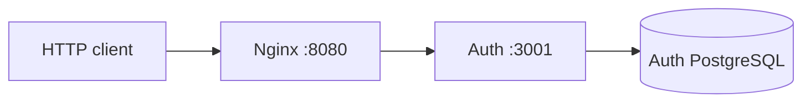
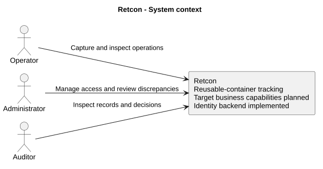
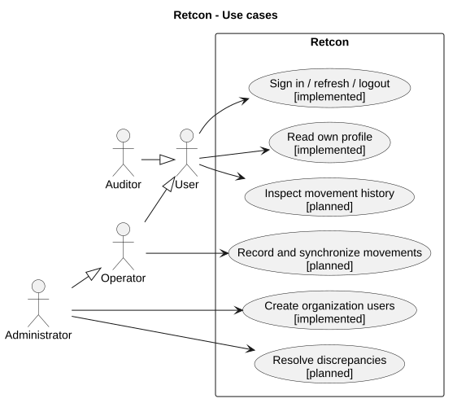

# My Auth architecture

This page describes the current executable architecture. The [future microservice architecture](../future/06-target-architecture.md) covers gRPC services for container accounting, settlements, logistics and tracking; those services are not implemented in this baseline.

I run one NestJS service and one PostgreSQL database in this milestone. Nginx provides the public entry point. My HTTP client uses the API; a working frontend is outside this delivery.

## Modules and ownership

| Module              | My responsibility                                       |
| ------------------- | ------------------------------------------------------- |
| ConfigurationModule | Standard ConfigModule and validated settings            |
| DatabaseModule      | TypeOrmModule.forRootAsync using ConfigService          |
| AuthModule          | Registration, login, token issuance, refresh and logout |
| UsersModule         | Current profile and ADMIN user creation                 |
| OrganizationsModule | Organization entity                                     |
| PlatformModule      | Guards, HTTP protection, logging, errors and health     |
| Shared contracts    | Roles and required principal claims                     |

## Data

I use organizations, users, sessions and refresh_tokens. A user belongs to one organization, a session to one user, and refresh records to one session. Email is globally unique in Identity.

I register organization, ADMIN and session transactionally. During refresh I lock the session row, reread the token, consume it and issue its replacement. Reuse of a consumed token revokes the family.

## Decisions

I choose NestJS for the requested TypeScript architecture, TypeORM and PostgreSQL for transactional relational data, bcrypt for passwords, and jsonwebtoken for RS256 signing and verification. I use ConfigService rather than a custom settings service, and class-validator rather than a separate validation framework.

JWT is a token format, not an OAuth or OpenID Connect server implementation. My current service does not provide federation, MFA, password reset or a browser BFF. I do not put secrets in JWT claims. Production schema delivery, TLS, backups and recovery need a separate operational procedure.

## Project context and diagrams

I distinguish the target product from the current executable components. Operators will capture business operations, administrators will manage access and review discrepancies, and auditors will inspect history. The business scenarios are planned; only Identity scenarios are implemented.

I keep editable sources and exports in the [diagram directory](../diagrams/README.md). Current Identity requirements map to Auth and its four tables; planned accounting requirements have no executable service in this revision. My [decisions](../decisions/README.md) describe the current choices.
