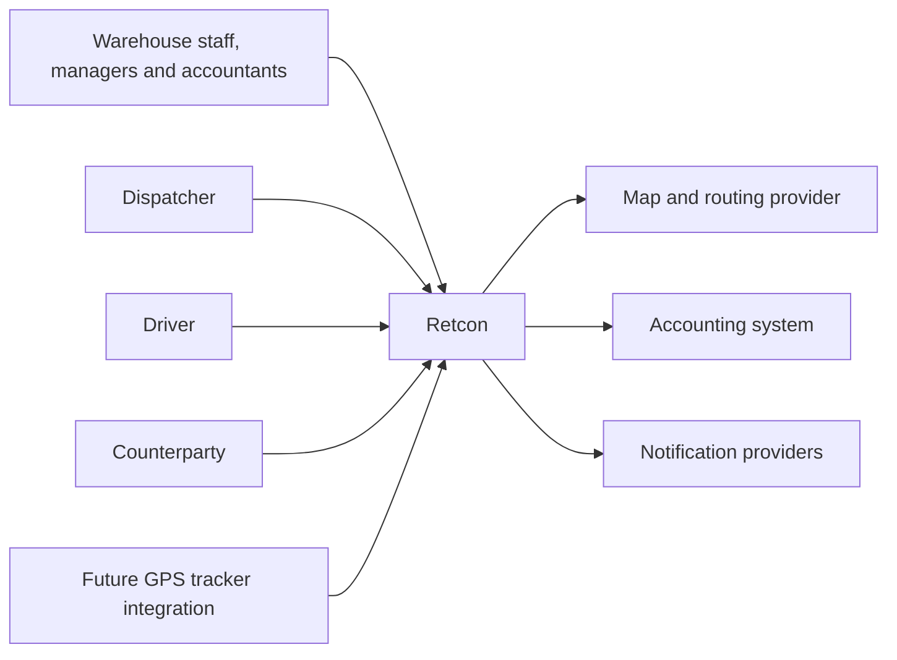
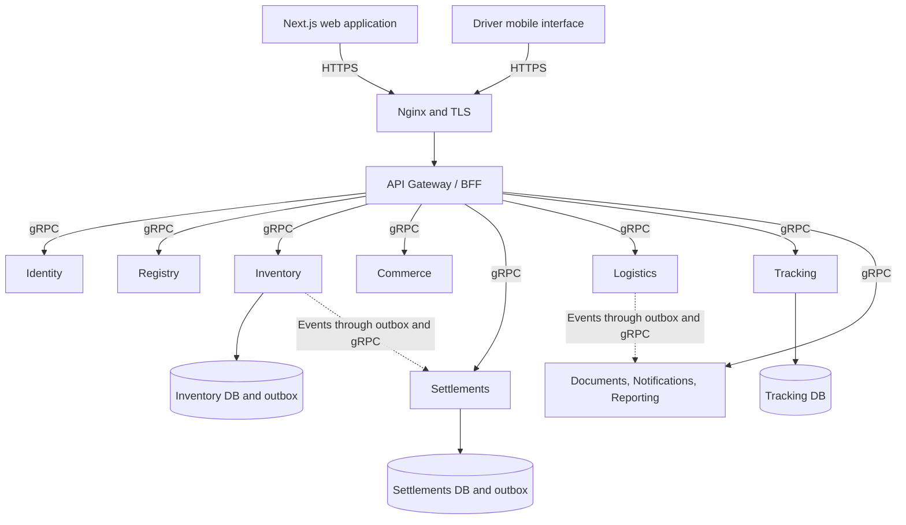

# Retcon target microservice architecture

## Architectural direction

The future Retcon system will consist of microservices communicating internally over **gRPC**, with **Protocol Buffers** contracts. Clients will access a server-side gateway over HTTPS, and the gateway will call the appropriate services over gRPC. SSE is proposed for browser map updates; commands and coordinate batches use the HTTP API.

This is the target architecture. The repository currently runs one HTTP Auth service behind Nginx, without gRPC dependencies or `.proto` contracts. New services will be introduced as complete business scenarios are implemented. The current arrangement is documented [separately](../architecture/overview.md).

## System context



External integrations sit behind adapters. A mapping outage should affect route display, not return posting. An unavailable accounting system leaves exports queued and does not cancel confirmed physical movements.

## Target components



The Support block groups three future responsibilities for readability; they are separated in the table below. Other services also own storage. The diagram shows only selected databases to avoid obscuring the main connections.

## Service boundaries

| Service                       | Responsibility and owned data                                                                             | Outside its ownership                               |
| ----------------------------- | --------------------------------------------------------------------------------------------------------- | --------------------------------------------------- |
| Identity, the existing `auth` | Organizations, users, sessions, roles and permissions                                                     | Balances and financial rules                        |
| Registry                      | Counterparties, sites, container types, products and basic characteristics                                | Individual movements and financial charges          |
| Inventory                     | Items, current states, reservations, movements, return obligations, stock counts and accounting conflicts | Payments and GPS                                    |
| Commerce                      | Contracts and term versions, requests, deliveries, expected lines and commercial bases                    | Authoritative warehouse balances                    |
| Settlements                   | Charges, deposits, payments, allocations, management ledger entries and periods                           | Physical container state                            |
| Logistics                     | Trips, stops, driver and vehicle assignments, and plan execution confirmations                            | Raw coordinates and warehouse movement posting      |
| Tracking                      | Devices, authorized tracking sessions, coordinates, latest positions and map updates                      | The authoritative acceptance fact                   |
| Documents                     | Files, templates, printable versions, attachments and generation results                                  | Independent modification of source accounting facts |
| Notifications                 | Subscriptions, templates, delivery queue and delivery outcomes                                            | Making business decisions for users                 |
| Reporting                     | Rebuildable projections for reports and summaries                                                         | The only copy of a financial or warehouse journal   |

In the MVP, Documents, Notifications and Reporting can be modules within the relevant process owner's service or separate workers. They become independent services when a demonstrated need arises. Identity, Inventory, Commerce, Settlements, Logistics and Tracking retain the defined domain boundaries even when introduced incrementally.

## Why gRPC

With gRPC, contracts define services and methods, while Protocol Buffers defines messages. This provides a shared interaction format across independent processes. gRPC supports ordinary request-response calls and streaming; the scenario determines which is appropriate. See the [official gRPC concepts](https://grpc.io/docs/what-is-grpc/core-concepts/).

Unary RPCs suit card retrieval, availability checks and movement commands. A server stream can connect Tracking to the gateway, which forwards updates to browsers over SSE. Using gRPC does not remove the need for input validation, authorization, deduplication or partial-failure handling.

Confirmed NestJS integration points include `Transport.GRPC`, `package` and `protoPath` options, the `@GrpcMethod()` handler and `ClientGrpc.getService()`. Their exact usage and compatibility with selected dependency versions must be verified in an initial technical prototype using the [NestJS documentation](https://docs.nestjs.com/microservices/grpc). These are documented implementation references, not dependencies already added to Retcon.

## Gateway and clients

Nginx terminates TLS and forwards public requests to the BFF. The BFF verifies the session, limits request size and frequency, creates user context and calls business services. It can assemble a screen from several reads but does not maintain a second implementation of accounting rules.

Protected cookies and server-side handling of sensitive tokens are proposed for browser sessions. CSRF protection, token renewal and logout are designed during the Identity phase. This extends the existing Auth service, which currently returns access and refresh tokens through HTTP APIs.

External clients do not receive direct network access to internal gRPC ports. Partner APIs will use separate credentials, scopes, limits and public contract versions. Access to the BFF does not authorize access to every organization.

## Data ownership

Each service owns its database, or a separate database on a shared PostgreSQL cluster with isolated credentials. Services do not write directly into another service's tables. Cross-service relationships use identifiers and necessary snapshots; distributed SQL foreign keys are not used.

Several databases can share a PostgreSQL instance in the MVP to simplify operations. This does not make them a common table pool: migrations, access and responsibility remain separate. PostgreSQL is the primary durable store. Redis, if introduced, serves caching and temporary update distribution rather than being the sole accounting journal.

Critical historical values are captured in document snapshots: names, rates, currency and term versions. Updating master data must not alter the meaning of a posted operation. A snapshot does not become the authoritative source for the current master-data record.

## Transactions and cross-service processes

Inside Inventory, state changes, the movement record, the idempotent command result and the outbox entry are created in one transaction. After commit, a separate worker delivers the event to its consumer over gRPC. In Settlements, the event passes through an inbox with a unique identifier; the inbox receipt and financial effect commit in one local transaction.

Delivery can repeat. Each consumer must handle duplicates safely, while the sender retains attempts and acknowledgement status. gRPC is not a durable queue; outbox and inbox tables plus restartable workers provide durability in the initial architecture.

A message broker can later replace event transport while preserving schemas and idempotency rules. Synchronous service commands and queries continue to use gRPC. A broker should address a measured load or coupling problem rather than being mandatory infrastructure on day one.

Long-running processes have a coordinator and explicit step states. Commerce coordinates request fulfillment, Logistics coordinates trip stops, and Settlements coordinates posting and export. There is no transaction spanning several databases. When a warehouse movement is posted but financial processing is delayed, the operation appears confirmed with settlement pending. A physical handover is not automatically reversed because of a network failure.

## Failures and retries

Every RPC receives a bounded waiting time. After a timeout, clients inspect the command result using its stable identifier: a timeout does not prove that the server did nothing. gRPC does not set a deadline by default; selection and propagation of the time budget must be implemented explicitly. See the [deadline guide](https://grpc.io/docs/guides/deadlines/).

Retries apply to safe reads and idempotent commands, have bounded attempts and use backoff with jitter. Business-rule failures are not retried indefinitely. The [gRPC retry guide](https://grpc.io/docs/guides/retry/) describes transport capabilities; Retcon's policy requires lost-response tests.

After attempts are exhausted, the outbox entry remains available for diagnosis and controlled replay. Alerts expose the oldest undelivered operation's age. Ordering uses the version of a particular aggregate; no global order of all system events is promised. A missing version triggers waiting or recovery through the data owner's RPC.

## Offline synchronization

Mobile and warehouse clients keep a local queue containing `operation_id`, the source object's version and observed time. The BFF accepts a batch and forwards each command to the relevant owner. A separate Sync service is unnecessary initially: it must not become another owner of warehouse rules.

The server returns an outcome for each operation: accepted, previously accepted, conflict, rejected or temporary failure. An expired session requires authentication recovery; a locally saved action does not bypass current permissions. Dependent actions retain predecessor references and processing order.

Queue submission runs when the application opens, when connectivity returns and when manually requested. Background Synchronization API may supplement delivery in supported browsers, but its limited availability means it cannot be the sole mechanism. See the [Background Synchronization documentation](https://developer.mozilla.org/en-US/docs/Web/API/Background_Synchronization_API).

## Security

Internal services authenticate the calling service and user context. mTLS is proposed for service connections, together with verifiable context restricted to the intended audience; the delegation mechanism will be recorded in a dedicated ADR. A `tenantId` or role in an ordinary header is not trusted by itself.

Authorization occurs both in the BFF and at the data owner. Every request is constrained by organization and user scope. The existing `AccessGuard` uses HTTP context; gRPC requires separate guards or interceptors rather than mechanically reusing an HTTP-only guard.

Secrets stay out of Git. Logs exclude tokens and private document content. Access and change audits have their own retention rules. Uploads have size and type limits, are checked before use and are returned only to authorized users. Coordinates and contacts do not appear in general public reports.

## Operations and observability

Every operation receives a correlation identifier propagated through HTTP, gRPC, the outbox and background jobs. Metrics distinguish technical performance from business state: RPC latency, errors, event backlog, unresolved conflicts and trips without fresh positions.

Services expose readiness and liveness checks, finish active work appropriately during shutdown and support sequential deployment of compatible contracts. Backups are verified by restoration. Recovery must account for consistency across several databases and event replay, including retained deduplication keys.

Development uses Docker Compose. Container orchestration can follow demonstrated operational requirements; Kubernetes is not a prerequisite for the first working version. Production preparation includes migrations, TLS, monitoring, secrets and a tested recovery procedure.

## Proposed repository structure

```text
retcon/
  frontend/                       web workspace and initial driver interface
  services/
    auth/                         existing Identity with later extensions
    gateway/                      HTTP BFF and SSE adaptation
    registry/                     master data
    inventory/                    containers and movements
    commerce/                     contracts and requests
    settlements/                  financial operations
    logistics/                    trips and stops
    tracking/                     coordinates and positions
    documents/                    later extraction of document responsibilities
    notifications/                later extraction of notifications
    reporting/                    later extraction of reporting projections
    shared/
      contracts/                  public types and proto/<domain>/v1
      platform/                   configuration, observability and transport adapters
      testing/                    shared integration-test utilities
    infra/                        gateway and infrastructure configuration
    compose.yaml
  tests/
    e2e/                          complete business scenarios
    load/                         reproducible load profiles
  docs/
    future/                       this concept and roadmap
    architecture/                 actual architecture as implementation progresses
    decisions/                    accepted ADRs
    diagrams/                     editable diagrams and exports
```

This is a proposed structure. New directories are created when their phases are implemented. Shared packages contain transport and technical infrastructure; one service's domain logic and ORM entities do not become shared dependencies of other services.

[Next — domain model and contracts](07-domain-and-contracts.md).
