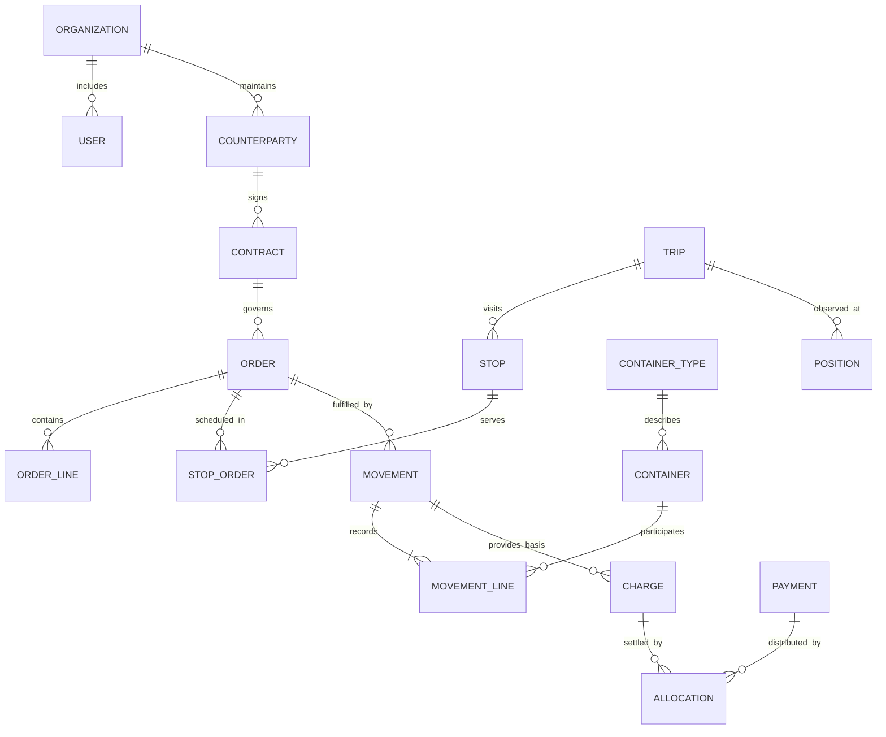
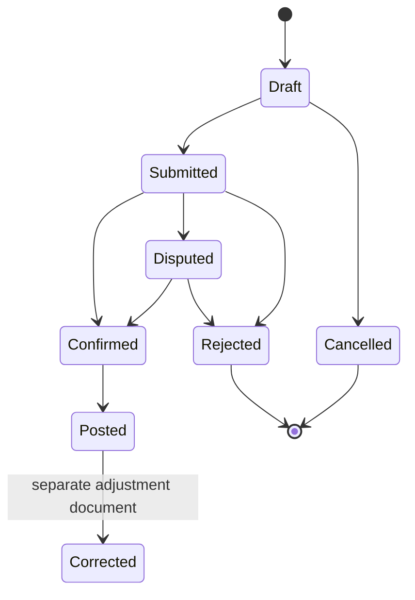
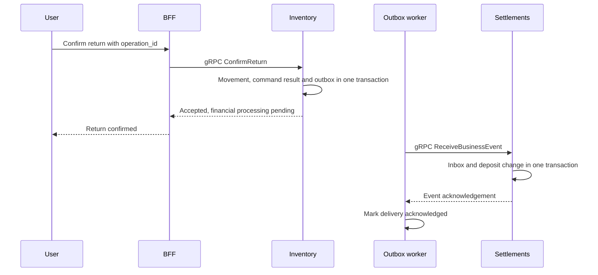

# Domain model and proposed contracts

## Shared domain language

A container is a returnable asset or an accounted quantity of identical assets. A product is the content of a delivery. The owner owns the container; the holder possesses it. A counterparty is a company's business partner, while a Retcon organization is an isolated workspace. These concepts may be related but are not interchangeable.

A transfer records a change in physical location or responsible holder. A request expresses intent, a trip represents transport execution, acceptance confirms a fact, and a charge is a financial consequence with a specific basis. A GPS point is a device observation, not an acceptance record.

## Main entities

| Domain          | Entities                                    | Main attributes and relationships                                      |
| --------------- | ------------------------------------------- | ---------------------------------------------------------------------- |
| Identity        | Organization, User, Session, Permission     | Organization, user, permissions and scopes                             |
| Registry        | Counterparty, Site, ContainerType, Product  | Business details, address, site coordinates, units and characteristics |
| Inventory       | Container, StockBucket, Reservation         | Type, owner, holder, location, condition and version                   |
| Inventory       | Movement, MovementLine, ReturnObligation    | Source, destination, items or quantities, contract and obligation      |
| Inventory       | CountSession, DiscrepancyCase, Resolution   | Observation, expected state, conflict and decision                     |
| Commerce        | Contract, ContractVersion, Order, OrderLine | Terms, effective period, products, containers, delivery and return     |
| Logistics       | Trip, Stop, Vehicle, Assignment             | Trip, stop order, capacity, driver, plan and actual outcome            |
| Tracking        | Device, TrackingSession, Position           | Device, authorized trip, time, coordinates and accuracy                |
| Settlements     | Charge, Payment, Allocation, DepositEntry   | Charge, payment, allocation and deposit movement                       |
| Settlements     | JournalEntry, JournalLine, AccountingPeriod | Balanced operation, lines and period                                   |
| Documents       | Document, DocumentVersion, Attachment       | Basis, version, file, approval status and checksum                     |
| Each data owner | OutboxEvent, InboxReceipt, AuditRecord      | Delivery, deduplication, actor, action and correlation                 |

`StockBucket` belongs to the future quantity-based mode. In the serialized MVP, balances can derive from item states and maintained projections. An item must not appear in both serialized and anonymous quantity balances without an explicit accounting-mode conversion.

## Conceptual relationships



The diagram shows conceptual relationships for the future serialized mode, not a single physical SQL schema. Cross-service links are resolved through identifiers and contracts. A charge may have another basis, such as a delivery service; not every return creates a charge.

## Container states

State is divided into independent dimensions. Location answers “where,” condition answers “is it serviceable,” lifecycle answers “is the asset active,” and reservation answers “to whom is its issue committed.” Combining “at customer,” “dirty” and “reserved” in one status field would mix different dimensions.

For example, a container is held by a customer, owned by the supplier, awaiting return and in an unknown post-use condition. After acceptance, it is at the warehouse in quarantine. Inspection makes it available or sends it for repair. A write-off removes the asset from circulation while retaining history.

Inventory checks whether an action is permitted. Written-off containers cannot be dispatched, containers reserved for another order cannot be issued without releasing that reservation, and a container held by a customer cannot be moved from a warehouse without a valid basis.

## Operation states



This is a common vocabulary for an accounting document; particular document types can combine steps. `Corrected` on the original means that a separate correction exists, not that its old lines were replaced. Local-queue transport statuses are separate: saved on device, uploading, accepted by server, conflict and sign-in required.

Trips have their own states: draft, planned, loading, in transit, completed and cancelled. Stops can be pending, current, completed, partially completed or unsuccessful. Completing a trip requires an outcome for every stop, while financial disputes can remain open after the journey ends.

## Invariants

1. Every accounting entity belongs to an organization; a user cannot select another organization through an unverified request field.
2. A serialized item has one confirmed current state and a monotonically increasing version.
3. A transfer does not change ownership without a separate documented basis.
4. Physical return reduces the return obligation exactly once; damage decisions are accounted for separately.
5. A posted operation preserves its original content. A correction references it and explains the change.
6. One command key has one result; another payload under the same key is rejected.
7. Payment allocations cannot exceed the payment, and a charge cannot be settled beyond the permitted amount without an explicit overpayment model.
8. Financial entries balance within a currency, with exact arithmetic for rates and amounts.
9. Coordinates do not post container movements or confirm receipt of products.
10. Access to one trip does not expose other customers' or trips' data.

## Example future gRPC contract

The following is a proposed internal contract for moving one serialized container. These Retcon methods and messages are not implemented yet. A multi-item transfer needs a separate contract that explicitly defines document-level atomicity or per-line outcomes.

```proto
syntax = "proto3";

package retcon.inventory.v1;

import "google/protobuf/timestamp.proto";

service InventoryService {
  rpc MoveContainer(MoveContainerRequest) returns (OperationResult);
  rpc GetOperation(GetOperationRequest) returns (OperationResult);
}

message MoveContainerRequest {
  string operation_id = 1;
  string container_id = 2;
  uint64 expected_version = 3;
  string from_location_id = 4;
  string to_location_id = 5;
  string source_document_id = 6;
  google.protobuf.Timestamp observed_at = 7;
}

message GetOperationRequest {
  string operation_id = 1;
}

enum OperationStatus {
  OPERATION_STATUS_UNSPECIFIED = 0;
  OPERATION_STATUS_APPLIED = 1;
  OPERATION_STATUS_CONFLICT = 2;
  OPERATION_STATUS_REJECTED = 3;
}

message OperationResult {
  string operation_id = 1;
  OperationStatus status = 2;
  optional uint64 resulting_version = 3;
  string reason_code = 4;
  string conflict_id = 5;
  google.protobuf.Timestamp recorded_at = 6;
}
```

The user, organization, caller service identity and trace context travel in a verifiable call context. The server separately checks access to `source_document_id`, locations and the item. Missing and empty values are validated at application level; successfully parsing protobuf does not make a business command valid.

When mapping `uint64` to JavaScript, it must not be converted to an ordinary `number` without checking precision. Generation and serialization must retain accuracy through `bigint` or a string representation. Packages are versioned; deleted field numbers and names are reserved and never reused. Format rules should follow the [Protocol Buffers guide](https://protobuf.dev/programming-guides/proto3/).

Transport errors use agreed gRPC codes such as `UNAUTHENTICATED`, `PERMISSION_DENIED` and `UNAVAILABLE`. A business conflict for an intention accepted for review returns a typed result with `conflict_id`. Checking `GetOperation` is required after an uncertain request outcome.

## Other proposed operations

| Owner          | Proposed methods                                        | Purpose                                                           |
| -------------- | ------------------------------------------------------- | ----------------------------------------------------------------- |
| Registry       | `GetCounterparty`, `GetSite`, `ListContainerTypes`      | Read permitted master data                                        |
| Commerce       | `CreateOrder`, `ConfirmOrder`, `GetContractSnapshot`    | Requests and fixed contractual terms                              |
| Inventory      | `ReserveContainers`, `ConfirmReturn`, `ResolveConflict` | Reservation, acceptance and discrepancy resolution                |
| Logistics      | `CreateTrip`, `AssignDriver`, `CompleteStop`            | Trip plan and stop outcome                                        |
| Tracking       | `IngestPositions`, `GetLatestPositions`, `WatchTrip`    | Coordinate batches, current positions and update stream           |
| Settlements    | `RegisterPayment`, `AllocatePayment`, `GetStatement`    | Payment, allocation and reconciliation                            |
| Event consumer | `ReceiveBusinessEvent`                                  | Idempotent event ingestion within the consumer service's contract |

These names are API design proposals, not existing SDK methods. Before implementation, each requires authorization rules, mandatory fields, idempotency, errors and boundary cases.

## Events and delivery

Proposed events include `inventory.movement_posted.v1`, `inventory.return_confirmed.v1`, `inventory.discrepancy_resolved.v1`, `logistics.stop_completed.v1`, `settlements.charge_posted.v1` and `settlements.payment_registered.v1`. Every event contains `event_id`, organization, type, time, aggregate, aggregate version, correlation and typed data.

An event describes a committed fact. A command asks for an action. Receiving `stop_completed` must not create a second warehouse return if one was already posted through a separate command. The accounting owner publishes the financial basis, and the consumer enforces uniqueness between a charge and that basis.



If the Settlements response is lost, the worker retries the same `event_id`. The consumer acknowledges the previously stored event without changing the deposit again. With multiple consumers, delivery status is tracked separately for each recipient.

## Idempotency and conflict handling

A command key is unique within an organization and API operation. The server retains a normalized fingerprint of business fields and the previous result. The same content returns that result; the same key with different fields is an error. The fingerprint uses an agreed canonical field model rather than incidental JSON ordering or protobuf byte order.

Version and transition validity are checked within a transaction. A conflict retains the intention, expected and actual versions, actor and reason. The result must not be lost by rolling back after recording the conflict: persisting a conflict and returning it form a separate successful processing branch.

Server versions determine sequence, not phone time alone. Device clocks can be wrong, and an operation can arrive hours later. Observed, received and posted times are therefore retained for different purposes.

## Storage and data growth

Indexes follow organization, document number, status, counterparty, period and container ID. Large lists use bounded page sizes and stable pagination. Movement history remains durable, while reporting projections can be rebuilt from facts.

Telemetry has a different profile: many small records and a limited period of relevance. It needs separate policies for detailed-point retention, history aggregation and deletion. Financial-document and audit retention is determined independently; deleting coordinates must not remove evidence that an operation was posted.

[Next — requirements and quality](08-requirements-and-quality.md).
