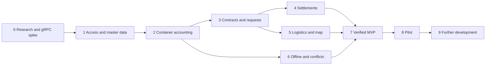

# Retcon phased delivery roadmap

## Organizing implementation

The project develops from existing Auth into a complete container circulation cycle, then into pilot operations. Each phase must produce observable behavior, documentation and verification. The number of services is not itself a readiness criterion.

The plan assumes individual development, with potential future contributors. Calendar deadlines and supervisor approval are not presented as agreed. After the technical prototype and user research, phases are divided into actual YouTrack tasks with estimates and dates.

New `FUT-*` references identify requirements in the [specification](08-requirements-and-quality.md). Actual `RET-*` IDs are added after tasks are created; existing IDs are not repurposed to describe invented completed work.

## Phase 0 Research and technical discovery

**Outcome.** One pilot process is clarified, and gRPC communication between NestJS services is demonstrated. Container type, participants, return conditions, financial bases and GPS source are identified.

Read the existing [Auth API](../prototype/api.md), [backend runbook](../architecture/backend.md) and [technical sources](10-sources-and-decisions.md). Discuss the process with warehouse staff, an accountant, a dispatcher and a driver; capture real document examples and distinguish assumptions. The supplied graduation requirements are mapped in the existing checklist; a planned interview is not evidence that an interview occurred.

For the technical spike, use the official NestJS `Transport.GRPC` and `@GrpcMethod()` patterns. Verify package compatibility, unary RPC, deadlines, `uint64` mapping, verifiable context propagation and retries. Record the outcome in an ADR and a minimal example in a future examples directory.

**Verification.** A test call travels from gateway to service; invalid context is rejected; timeout and unavailability are reproducible. A table distinguishes confirmed decisions and open questions.

**Guards.** Do not invent library APIs, label a spike as a business feature or present assumptions as research findings. Resolve the frontend/backend pnpm version difference before unifying tooling.

## Phase 1 Access platform and master data

**Outcome.** A user signs into their organization's workspace, sees permitted sites and can prepare accounting master data.

Extend Identity, create the BFF and Registry, and define permissions. Reuse existing Auth methods and configuration according to the [current runbook](../architecture/backend.md). Adapt HTTP protection through a separate transport layer; implement gRPC checks using the verified phase 0 spike. Add migrations and isolated service credentials.

**Verification.** FUT-01–03; negative cross-organization scenarios; import preview; current startup instructions. CI passes build, type checks, lint, formatting and new access-control checks.

**Guards.** Do not trust an organization from the request body or attach an HTTP-only guard to RPC without adaptation. Do not change users to multi-organization membership without an explicit decision.

## Phase 2 Container register and movements

**Outcome.** Users can register items, reserve, issue and return them, then inspect history and balances.

Create Inventory according to the [domain model](07-domain-and-contracts.md) and [accounting rules](03-accounting-and-settlements.md). Implement the proposed contracts after phase 0 validation, local transactions, versions, idempotency, movement history and outbox. Add item cards, scanning with manual entry, and transfer forms.

**Verification.** FUT-04–06 and FUT-15; concurrent issue of one item; retry after a lost response; partial return; invalid condition; corrections through a separate basis.

**Guards.** Do not update a balance alone without history, repair posted movements through direct SQL or introduce a distributed transaction across services.

## Phase 3 Contracts requests and connected circulation

**Outcome.** A delivery includes products and containers, its related issue and an expected return. The complete physical cycle works before the transport map is introduced.

Create Commerce, contract-term versions, request lines, fulfillment states and Inventory links. Follow the delivery scenario in the [UX description](05-scenarios-and-ux.md). Define partial acceptance and disputed quantities; add basic handover and return documents.

**Verification.** FUT-07–08 and the foundation of FUT-19; master-data changes do not alter old documents; contract changes do not recalculate posted issues; partial fulfillment retains the remaining obligation.

**Guards.** Do not mix product and packaging quantities, or order intent and physical handover. Do not issue containers without checking availability.

## Phase 4 Settlements deposits and the accountant workspace

**Outcome.** Confirmed operations have explainable financial consequences, with payments and reconciliation available.

Create Settlements, its journal, deposit entries, charges and allocations. Implement exact arithmetic, term versions and separate balance categories using the [settlement model](03-accounting-and-settlements.md). Add a gRPC event consumer with inbox, safe retries and visible financial-processing delays.

**Verification.** FUT-17–19 and FUT-N02–03; the reproducible example with 100 issued and 80 returned crates; lost event acknowledgement; partial payment; reversal; no duplicate payment after repeated import.

**Guards.** Do not treat deposits as revenue by default, recognize agreed damage before a decision or present the management ledger as completed statutory accounting. Recording a payment does not simulate an actual money transfer.

## Phase 5 Trips drivers and the supplier map

**Outcome.** The map shows a supplier delivering products in containers or travelling to collect returns; stops link to accounting documents.

Create Logistics and Tracking, driver assignments, stop order, coordinate batch ingestion and SSE through the BFF. Implement the mobile workflow from the [logistics plan](04-logistics-and-live-map.md). Select mapping and routing providers after checking coverage, pricing and terms; study the chosen SDK's official documentation before writing its adapter.

**Verification.** FUT-09–13; stale and delayed coordinates; unavailable GPS; partial collection; map outage; counterparty permissions; prevention of trip changes by an unassigned driver. Evaluate the [quality workload profile](08-requirements-and-quality.md).

**Guards.** Do not post acceptance from a geofence, present an old point as current or promise background tracking in an untested browser. Do not make accounting depend on an external routing provider.

## Phase 6 Offline operations and conflict review

**Outcome.** Warehouse staff and drivers continue recording without connectivity and receive understandable synchronization outcomes afterward.

Implement local storage, a durable queue, versions, dependent operations and restart recovery. Following the [synchronization architecture](06-target-architecture.md), expose per-operation statuses. Create the conflict center and controlled resolution flow from the [UX scenario](05-scenarios-and-ux.md).

**Verification.** FUT-14–16; a day offline using a fixed dataset; client restart; renewed sign-in; incompatible changes; lost response; unavailable or full local storage.

**Guards.** Do not resolve accounting conflicts with a silent last-write-wins policy. Do not depend on Background Sync for correctness or treat local saving as server confirmation.

## Phase 7 Complete MVP and demonstration

**Outcome.** A working version demonstrates the entire path from request to reconciliation, including the map, a return, an offline operation and a conflict.

Complete internal notifications, basic reports and exports. Assemble the end-to-end scenario using fixed data, and update actual architecture, APIs, instructions and diagrams. Check implementation against approved contracts and `FUT-*` criteria.

**Verification.** All MVP requirements, current Auth checks, new integration tests and end-to-end tests. Regenerate contracts, check for prohibited bypasses of data ownership, and validate formatting and links. Record results with environment, date, limitations and reproduction steps.

**Guards.** Source presence does not establish a passed scenario. A prepared map animation is not evidence of working coordinate ingestion.

## Phase 8 Pilot and operational verification

**Outcome.** One company can use the system in an agreed operational process and recover it after a failure.

Add period closure, stock counts, a restricted counterparty portal and one selected accounting connector. Verify the operational GPS source, backup and restoration, monitoring, service upgrades and access revocation. Train participants and collect actual feedback.

**Verification.** FUT-21–25 and FUT-N05–09; confirmed backup restoration; export and reconciliation with the accounting system; usefulness metrics under documented conditions. Significant decisions and supervisor comments are recorded after real discussion.

**Guards.** Do not turn a learning environment's limitations into production SLA promises. Do not expose partner access before checking all read paths, including reports and file links.

## Phase 9 Further development

**Outcome.** The system expands to confirmed needs without weakening core accounting reliability.

Add quantity-based accounting, container maintenance, further integrations and analytical forecasts. Consider route optimization after sufficient data exists and a verifiable objective is defined, such as minimizing travel time subject to mandatory windows and capacity.

**Verification.** FUT-26–28; contract compatibility; migration of a copy of real data; comparison with the baseline model on identical tasks. Each new automation explains its inputs and allows human review.

**Guards.** Do not build forecasts on unverified history or hide recommendation uncertainty. Do not introduce event transport or infrastructure without evaluating benefits and support cost.

## Phase dependencies

Phases 4 and 5 have independent portions, but sequential implementation is reasonable for one developer. The offline protocol is considered in contracts from phase 2 even though the full synchronization interface appears later.

## Main risks and responses

| Risk                        | Symptom                                                  | Response                                                                 |
| --------------------------- | -------------------------------------------------------- | ------------------------------------------------------------------------ |
| First release is too broad  | Many started modules without a complete cycle            | Limit data and contract variants while retaining the end-to-end scenario |
| Unverified accounting rules | Calculations work technically but do not fit the company | Review actual documents with an accountant before phase 4                |
| Microservice complexity     | Network failures and divergent data                      | Standardize RPC, transactions, outbox, inbox and diagnostics             |
| Local data loss             | Operations disappear after device storage is cleared     | Explicit queue states, tested limits and recovery procedures             |
| Unstable geolocation        | Outdated map points                                      | Freshness, accuracy, address-list fallback and a verified source         |
| Incorrect contract handling | Old documents receive the wrong deposit rate             | Versioned terms and fixed snapshots                                      |
| Poor opening data           | Correct calculations over incorrect initial balances     | Reconcile opening balances and document their entry                      |
| Integration or report leak  | Other parties' documents are accessible by link          | Negative tests and consistent access scopes                              |
| No actual evaluation        | Benefits claimed without measurement                     | Define baseline, dataset and experiment protocol beforehand              |

## Demonstrating the completed result

Begin with a customer card and circulation terms. Create a delivery, reserve containers and plan a trip. The vehicle appears on the map, the customer sees its visit, and the driver records handover and a partial return. Save one document offline; reconnect to produce a prepared, verifiable conflict. An employee resolves it, and the accountant opens the statement and explains the remaining deposit.

Finally, show history, a retried command without duplication and the link from a requirement to its test. This demonstrates engineering coherence: a user action travels through the interface, contract, data and settlement while retaining an explainable outcome.

[Next — sources and open decisions](10-sources-and-decisions.md).
